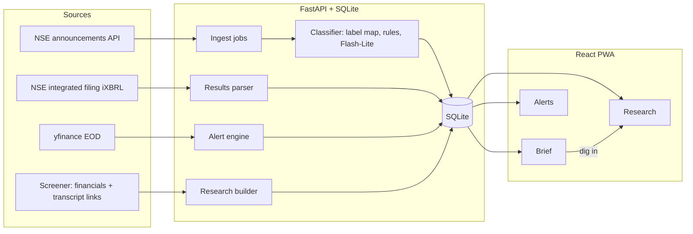

# FINN

A mobile-first investing agent for Indian equities. It reads every NSE filing and end-of-day move across your portfolio, tells you the few that matter, and checks what management said against what they delivered.

Built for the ENAM Holdings AI Engineer Build Challenge (27 Oct to 1 Nov 2026).

> **Status:** in progress. Sections marked *(planned)* are not built yet. Nothing in this README describes a feature as done unless it runs. Claims about data sources and models link to [docs/EVIDENCE.md](docs/EVIDENCE.md), where each one was checked live.

**Try it on your phone:** *(link goes here once deployed)*

---

## The idea in one line

**FINN is a brief you can finish, not a feed you scroll.**

Most investor apps are infinite: more filings, more news, more charts. FINN does the opposite. Every morning it gives you a short, ranked list of what changed in your portfolio. Each item says why you should care, in one line, with the numbers attached. You mark it done or dig in. When the list is empty, you are caught up, and FINN says so.

Two things follow from that:

1. **Routine paperwork is counted, not shown.** "31 routine filings, nothing material" is one tappable line at the bottom. You can audit it, but you never have to read it.
2. **Every push item is a door into research.** A results card does not stop at the numbers. "Dig in" opens the company's research brief at the exact place that answers the next question: did this quarter land where management said it would?

## What it does

### Push: the daily brief

| Feature | What you see | How it works |
| --- | --- | --- |
| Windowed digest | All portfolio filings in a window you pick (24h default, 3d, 7d, custom), sorted into **Needs you**, **Worth knowing**, and a collapsed **Routine** line. | Three-stage classifier: exchange label, then text rules, then a small model only for what is left. In October 2026, 50% of filings resolved from the label alone and 23% needed a model ([E3](docs/EVIDENCE.md#e3-exchange-labels-alone-are-not-enough-to-classify)). |
| Results card | Revenue, EBITDA, PBT, PAT for the quarter, with QoQ and YoY change. Banks get pre-provision profit and provisions instead of EBITDA. | Parsed from the exchange's own iXBRL filing, not generated. Checked against Screener for all 22 companies: revenue within 0.02% for 20 of them, PAT within 0.8% for 21. Any line more than 1% off is marked "check" on the card ([E6](docs/EVIDENCE.md#e6-quarterly-results-numbers-are-available-as-structured-data), [E15](docs/EVIDENCE.md#e15-parsed-results-agree-with-screener-across-all-22-companies)). |
| Management change card | Who joined or left, their role, and a 3-line career background with source links. | Name, role and the appointee's profile are read from the filing PDF, because the exchange summary does not name the person ([E4](docs/EVIDENCE.md#e4-management-change-filings-do-not-name-the-person-in-the-summary)). A web search for career history fills in the rest. A background counts as confident only if one of its sources names the appointing company; otherwise the card warns it may be a namesake ([E5](docs/EVIDENCE.md#e5-person-search-is-ambiguous-so-bios-need-disambiguation), [E18](docs/EVIDENCE.md#e18-model-mistakes-caught-while-enriching-filings-and-the-guards-added)). Changes at a subsidiary are labelled as such and ranked lower. |
| Everything else | A one-line summary next to the filing, at the priority the category deserves (table below). | Summary from the company's own one-liner where it is enough; a model only when it is not. |
| Threshold alerts | Price move beyond ±X% in a day, volume above Y times the 20-day average, and categories you always want to hear about. | You set X and Y with sliders. *(planned)* While you drag, FINN replays the last 60 days and shows how many alerts those settings would have fired, so you can tune "unusual" with real data instead of guessing. |

**How FINN decides what needs you.** This is a judgment call, so here it is in the open:

| Category | Default priority | What the card adds |
| --- | --- | --- |
| results | Needs you | Headline table, then "vs guidance" link into Pull |
| management_change (CEO, CFO, MD, KMP) | Needs you | Who, from where, sources |
| management_change (other directors) | Worth knowing | One line |
| litigation (regulator order, NCLT, insolvency) | Needs you | One line, which court or regulator |
| credit_rating downgrade, pledging increase | Needs you | Old vs new rating or pledge % |
| credit_rating upgrade | Worth knowing | Old vs new rating |
| M&A, fund_raise, capex | Worth knowing | One line, size where the filing states it |
| dividend, bonus_split | Worth knowing | Amount and record date |
| insider_trading (promoter sale) | Worth knowing | Who, how much |
| press_release | Worth knowing if it is an order win or launch, else Routine | One line |
| earnings_call, investor_meetings, postal_ballot, agm_egm, credit_rating reaffirmed, unclassified | Routine | Collapsed |

You can move any category up or down. The defaults are a starting opinion, not a rule.

### Pull: the research brief

Search any NSE ticker. FINN builds a brief from primary sources only: exchange filings, Screener's standardised financials (taken from the companies' audited statements), and concall transcripts. Reading the annual report itself is *(planned)*; links to it are shown. No news, no broker notes, and the model is told not to use what it already knows about the company.

| Section | What it answers | Source |
| --- | --- | --- |
| Snapshot | What the company does, headline numbers and ratios now. | Screener tables |
| Trajectory | What is growing and what is compressing over 5 years. | Screener tables, computed in Python |
| Cash quality | Do profits turn into cash? CFO to EBITDA, working-capital days, debt to equity. | Screener tables, computed in Python |
| **Promise ledger** | What management guided in the last four concalls, and what actually happened. | Transcripts and Screener quarterly numbers |
| Bull and bear | The tightest case each way, every point cited. | Everything above |
| Ask | Follow-up questions, answered only from the last four transcripts, with page citations. | Transcripts |

**The promise ledger is the centre of Pull.** For each guidance statement ("we expect 12 to 14% revenue growth this year"), FINN records the metric, the target, the timeframe, the exact quote and the page. Then it checks the outcome:

- **Delivered** or **Missed**: decided in Python against reported numbers when the promise is numeric.
- **Pending**: the timeframe has not ended.
- **Revised**: a later call changed the target. FINN shows both quotes side by side.
- **Dropped**: the promise was never mentioned again. This is often the most telling one.

Qualitative promises ("we will expand into the US") are judged by the model, labelled as model judgment, and shown with the later quote it relied on.

**Banks and NBFCs:** EBITDA does not mean anything for a lender, so FINN does not show it for one. BAJFINANCE is in the demo set to keep this honest.

## Where AI is used, and where it is not

The rule: **models read and judge text. Python does arithmetic.** No percentage, ratio, growth rate or unit conversion is ever produced by a model.

| Task | Method | Why |
| --- | --- | --- |
| Results numbers, QoQ, YoY | Parse iXBRL, compute in Python | Exact numbers exist in structured form ([E6](docs/EVIDENCE.md#e6-quarterly-results-numbers-are-available-as-structured-data)). A model could only add error. |
| Price and volume alerts | Python over stored EOD data | Thresholds are arithmetic. |
| Filing classification, first 213 of 275 (77%) | Exchange label map, then keyword rules | Free, instant, auditable ([E3](docs/EVIDENCE.md#e3-exchange-labels-alone-are-not-enough-to-classify)). |
| Filing classification, remaining 23% | `gemini-3.1-flash-lite`, 20 filings per call | Cheapest Gemini 3 tier, free on the free tier ([E10](docs/EVIDENCE.md#e10-gemini-model-availability-and-free-tier-checked-against-google-docs)). 63 filings took 4 calls and about 9 seconds ([E3](docs/EVIDENCE.md#e3-exchange-labels-alone-are-not-enough-to-classify)). |
| One-line summary of a vague filing | Flash-Lite reads the first pages of the PDF, 5 filings per call | Exchange summaries like "General Updates" say nothing. Batching keeps us under the free tier's 15 requests a minute ([E17](docs/EVIDENCE.md#e17-free-tier-limits-hit-in-practice)). |
| Name and role from a management-change PDF | Flash-Lite, structured output | Short extraction task. |
| Executive background | The filing's own profile first, then `ddgs` web search and Flash-Lite to condense with sources | Gemini's built-in Search grounding is not on the free tier for Gemini 3 models ([E10](docs/EVIDENCE.md#e10-gemini-model-availability-and-free-tier-checked-against-google-docs)). |
| Guidance extraction, promise ledger, bull and bear, Ask | `gemini-3.6-flash` with low thinking, structured output; `gemini-3.8-flash` as fallback | On one TCS transcript, 3.6 Flash took 7 s, 3.8 Flash 40 s, and 3.8 Flash often returned 503 on the free tier ([E14](docs/EVIDENCE.md#e14-reasoning-model-latency-on-the-free-tier)). The ledger re-sends the same transcripts, and Gemini's implicit caching served 124k of 324k input tokens from cache ([E17](docs/EVIDENCE.md#e17-free-tier-limits-hit-in-practice)). |

**Rate limits and outages are handled in one place** (`backend/llm.py`): calls are spaced to each model's per-minute limit, 429s wait for the delay the API asks for, and repeated 503s fall back to a sibling model ([E17](docs/EVIDENCE.md#e17-free-tier-limits-hit-in-practice)).

**Why not Gemini 2.5:** Google now limits 2.5 models to accounts that already used them and tells new projects to use 3.5 Flash-Lite or 3.8 Flash ([E10](docs/EVIDENCE.md#e10-gemini-model-availability-and-free-tier-checked-against-google-docs)).

**Guards against made-up answers:**

1. The model only sees text FINN extracted from the source documents.
2. Every claim must carry a document and page.
3. After the model answers, FINN checks that each quoted sentence actually appears in the source text. Claims whose quote is not found are dropped before they reach the screen.
4. If the sources do not cover a question, the answer says so.

**Cost tracking:** every model call is logged in the `llm_calls` table with model, tokens in, out, cached and thinking, and latency; `GET /api/meta` returns the totals. The totals for a full demo run will be reported here as measured numbers, not estimates.

## Architecture



- **Backend:** Python 3.12, FastAPI, Pydantic v2, SQLite. Ingestion runs on a schedule and writes to SQLite; the API only reads, so the app stays fast even when a source is slow.
- **Frontend:** React, Vite, Tailwind CSS, shadcn/ui, installed as a PWA so it opens like an app from the home screen.
- **Demo resilience:** a pre-filled SQLite snapshot ships with the repo. If NSE or Screener rate-limits the deployed server during review, the app still runs on the snapshot and says how old the data is.

## Data sources and what we learned about them

| Source | Used for | Gotcha found while probing |
| --- | --- | --- |
| NSE `corporate-announcements` | Every filing | Needs a cookie from the NSE homepage first, even though the homepage returns 403 ([E1](docs/EVIDENCE.md#e1-nse-corporate-announcements-api-works-without-a-browser)). |
| NSE `integrated-filing-results` | Quarterly results numbers | The older `corporates-financial-results` endpoint stops at Dec 2024 ([E6](docs/EVIDENCE.md#e6-quarterly-results-numbers-are-available-as-structured-data)). Values are in Rs lakh. |
| yfinance | EOD price and volume | The latest day sometimes has volume but no close. FINN drops those rows ([E9](docs/EVIDENCE.md#e9-yfinance-works-with-one-data-quality-trap)). |
| NSE transcript filings | Concall transcripts for the promise ledger | Used ahead of Screener's links, one of which pointed to a call from a year earlier ([E16](docs/EVIDENCE.md#e16-screeners-transcript-links-can-be-wrong-nse-filings-are-the-better-source)). Some attachments are zips holding the PDF. |
| Screener | Multi-year financials, ratios, transcript fallback | Transcript PDFs on BSE need a BSE `Referer` header ([E8](docs/EVIDENCE.md#e8-concall-transcripts-are-text-pdfs-of-manageable-size)). |

## Companies

**Portfolio (18):** RELIANCE, TCS, HDFCBANK, ICICIBANK, INFY, LT, ETERNAL, TRENT, BAJAJ-AUTO, TATACONSUM, DIXON, POLYCAB, PERSISTENT, SONACOMS, MAXHEALTH, SUZLON, KAYNES, GRAVITA. Large, mid and small caps across energy, IT, banking, capital goods, consumer, auto, electronics, healthcare and recycling. All 18 verified on yfinance and Screener ([E9](docs/EVIDENCE.md#e9-yfinance-works-with-one-data-quality-trap)).

**Ad-hoc research:** ASIANPAINT, HAL, PIDILITIND, BAJFINANCE ([E13](docs/EVIDENCE.md#e13-ad-hoc-research-picks-have-the-sources-pull-needs)). The research engine is not tied to these. Any NSE symbol with a Screener page works, and common old names map to new ones (ZOMATO to ETERNAL).

## What we left out, on purpose

- **Intraday data.** The brief asks for end-of-day. Intraday would add cost and noise without changing the workflow.
- **Voice.** A spoken brief is a nice demo but adds little over a 30-second read. Next on the list, not now.
- **A chat-first interface.** Chat makes the investor do the work of asking. FINN leads with a finished brief and keeps Ask for follow-ups.
- **Vector search.** Four transcripts fit in one model call ([E8](docs/EVIDENCE.md#e8-concall-transcripts-are-text-pdfs-of-manageable-size)). Retrieval would add moving parts for no gain at this size.
- **News and broker research.** Excluded from Pull by design: primary sources only.

## Run it locally

```bash
# backend
cp .env.example .env            # add GEMINI_API_KEY
uv sync
uv run uvicorn backend.main:app --port 8000

# frontend
cd frontend
bun install
bun run dev                     # http://localhost:5173
```

No `uv`? `python -m venv .venv && source .venv/bin/activate && pip install -r requirements.txt` works too.

## Where it goes next

- Push the promise ledger into the brief: when a new transcript lands, FINN tells you which promises changed status.
- Express order wins and capex as a share of annual revenue, so "Rs 500 crore order" means something.
- Real phone notifications for threshold alerts.
- A labelled evaluation set for the classifier that grows with every filing a user re-ranks.

## Build history

The Claude Code sessions used to build FINN are exported in `build-history/` *(planned)*.
