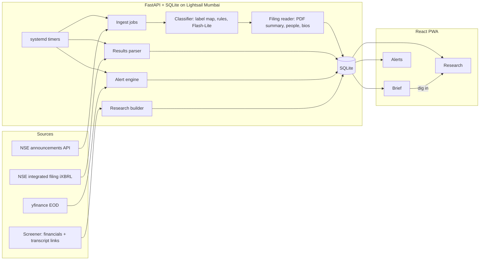

# FINN

A mobile-first investing agent for Indian equities. It reads every NSE filing and end-of-day move across your portfolio, tells you the few that matter, and checks what management said against what they delivered.

Built for the ENAM Holdings AI Engineer Build Challenge (27 Oct to 1 Nov 2026).

> **Status (31 Oct 2026):** FINN runs end to end on live data on an AWS Lightsail server in Mumbai: scheduled ingestion, classification, results, management cards, alerts, research, the promise ledger and Ask, behind a FastAPI app with a mobile web app installable to the home screen. Anything marked *(planned)* is not built yet; nothing here is described as done unless it runs. Claims about data sources and models link to [docs/EVIDENCE.md](docs/EVIDENCE.md), where each one was checked live. The build order and what is left are in [plan.md](plan.md).

**Try it on your phone:** https://finn-mu-three.vercel.app (open in the phone browser, then Add to Home Screen)

---

## The idea in one line

**FINN is a brief you can finish, not a feed you scroll.**

Most investor apps are infinite: more filings, more news, more charts. FINN does the opposite. Every morning it gives you a short, ranked list of what changed in your portfolio. Each item says why you should care, in one line, with the numbers attached. You mark it done or dig in. When the list is empty, you are caught up, and FINN says so.

Two things follow from that:

1. **Routine paperwork is counted, not shown.** "31 routine filings, nothing material" is one tappable line at the bottom. You can audit it, but you never have to read it.
2. **Every push item is a door into research.** A results card does not stop at the numbers. "Dig in" opens the company's research brief at the exact place that answers the next question: did this quarter land where management said it would?

## What it does

### Push: the daily brief

| Feature | What you see | How it works |
| --- | --- | --- |
| Windowed digest | All portfolio filings in a window you pick (24h default, 3d, 7d, custom), sorted into **Needs you**, **Worth knowing**, and a collapsed **Routine** line. | Three-stage classifier: exchange label, then text rules, then a small model only for what is left. In October 2026, 50% of filings resolved from the label alone and 23% needed a model ([E3](docs/EVIDENCE.md#e3-exchange-labels-alone-are-not-enough-to-classify)). |
| Results card | Revenue, EBITDA, PBT, PAT for the quarter, with QoQ and YoY change, then EBITDA and PAT margins with their change in basis points. Also: other income as a share of PBT (flagged at 25% or more), how the stock traded in the first session after the filing, and the company's promise ledger in one line. Banks get pre-provision profit and provisions instead of EBITDA. | Parsed from the exchange's own iXBRL filing, not generated. Checked against Screener for all 22 companies: revenue within 0.02% for 20 of them, PAT within 0.8% for 21. Any line more than 1% off is marked "check" on the card ([E6](docs/EVIDENCE.md#e6-quarterly-results-numbers-are-available-as-structured-data), [E15](docs/EVIDENCE.md#e15-parsed-results-agree-with-screener-across-all-22-companies)). |
| Management change card | Who joined or left, their role, and a 3-line career background with source links. | Name, role and the appointee's profile are read from the filing PDF, because the exchange summary does not name the person ([E4](docs/EVIDENCE.md#e4-management-change-filings-do-not-name-the-person-in-the-summary)). A web search for career history fills in the rest. A background counts as confident only if one of its sources names the appointing company; otherwise the card warns it may be a namesake ([E5](docs/EVIDENCE.md#e5-person-search-is-ambiguous-so-bios-need-disambiguation), [E18](docs/EVIDENCE.md#e18-model-mistakes-caught-while-enriching-filings-and-the-guards-added)). Changes at a subsidiary are labelled as such and ranked lower. Each person is tagged top management, board or senior staff from the role, with the effective date. |
| Everything else | A one-line summary next to the filing, at the priority the category deserves (table below). When the filing states an amount (an order, a deal, a capex plan, a claim), the card shows it as a share of annual revenue, and for fund raises and deals as a share of market cap. Every card says how many filings it covers and since when. | The company's own one-liner where it is enough. When it is not ("General Updates", "Disclosure under Regulation 30"), Flash-Lite reads the first pages of the PDF. Example: Polycab's insolvency filings turned out to concern an alleged operational debt of Rs 2.79 crore, against about Rs 9,900 crore of revenue that quarter ([E18](docs/EVIDENCE.md#e18-model-mistakes-caught-while-enriching-filings-and-the-guards-added)). |
| Threshold alerts | Price move beyond ±X% in a day, volume above Y times the 20-day average, and categories you always want to hear about. | You set X and Y. FINN replays the last 60 sessions and shows how many alerts those settings would have fired, so you tune "unusual" with real data. It matters: ±3% or 2x fires 119 alerts in 60 sessions across the portfolio, ±5% or 3x fires 25 ([E23](docs/EVIDENCE.md#e23-alert-thresholds-matter-and-research-works-on-a-ticker-finn-never-saw)). The count updates as you drag the sliders. Each move in the brief says what the company filed between the previous close and that close, or that nothing on record explains it. |

**Beyond the two examples in the brief** (the incoming person's background, and the four headline numbers), every card adds the context a professional checks next, computed in Python from data FINN already holds ([E28](docs/EVIDENCE.md#e28-beyond-the-briefs-two-examples-what-each-card-adds-and-the-reference-glossary)). Categories follow the reference glossary, and EBITDA is the operating version (other income excluded), labelled as such on the card.

**How well it sorts.** On 60 filings labelled blind (20 per stage), FINN's category matched on 57 and its priority on 48 before any fixes. On 30 more held out from those fixes, category matched on all 30 and priority on 25 (83%). The misses traced to code, not to the model's reading: one exchange label hid a Rs 4,265 crore QIP, press releases were judged on too few keywords, and the model's "senior" flag let independent directors into Needs you. Seniority is now a rule on the role. The labelled filings run as a regression test in CI ([E27](docs/EVIDENCE.md#e27-classifier-eval-60-blind-labelled-filings-then-30-held-out)).

**How FINN decides what needs you.** This is a judgment call, so here it is in the open:

| Category | Default priority | What the card adds |
| --- | --- | --- |
| results | Needs you | Headline table, then "vs guidance" link into Pull |
| management_change: a senior person joins or leaves the listed company | Needs you | Who, from where, sources |
| management_change: other directors, redesignations, or any change at a subsidiary | Worth knowing | Who, and which company |
| management_change: reappointments only | Routine | Collapsed |
| litigation (regulator order, NCLT, insolvency) | Needs you | One line, which court or regulator |
| credit_rating downgrade, pledge created or invoked | Needs you | One line from the filing |
| credit_rating upgrade, pledge released | Worth knowing | One line from the filing |
| M&A, fund_raise, capex | Worth knowing | One line, and the amount as a share of annual revenue when stated |
| dividend declared, bonus_split | Worth knowing | One line from the filing |
| insider_trading (promoter sale) | Worth knowing | One line from the filing |
| press_release | Worth knowing if it is an order win or launch, else Routine | One line |
| earnings_call, investor_meetings, postal_ballot, agm_egm, credit_rating reaffirmed, unclassified | Routine | Collapsed |

The defaults are a starting opinion, not a rule. Today you choose which categories trigger alerts; moving a category's priority up or down is *(planned)*. All of this is code in `backend/classify.py` (`priority`) and `backend/enrich.py` (`management_priority`).

### Pull: the research brief

Search any NSE ticker. FINN builds a brief from primary sources only: exchange filings, Screener's standardised financials (taken from the companies' audited statements), and concall transcripts. Reading the annual report itself is *(planned)*; links to it are shown. No news, no broker notes, and the model is told not to use what it already knows about the company.

| Section (in the order of the challenge brief) | What it answers | Source |
| --- | --- | --- |
| Business | What the company does; revenue mix by segment, segment margin, growth and share shift from a year ago. | NSE results filing (segment table), Screener description |
| Financial snapshot | Market cap, P/E, ROCE or ROE, TTM revenue, margin and net profit, debt to equity (price to book for lenders), latest quarter with QoQ and YoY. | Screener tables, NSE results filing |
| Trajectory | What is growing and what is compressing over 5 years. | Screener tables, computed in Python |
| Balance sheet | Borrowings, debt to equity, interest coverage, funding mix (deposits for banks), capital work in progress, working-capital days. | Screener tables, computed in Python |
| Cash quality | Do profits turn into cash? CFO to operating profit, operating and free cash flow. | Screener tables, computed in Python |
| **Narrative vs numbers** | The promise ledger: what management promised on past calls, and what happened. | Transcripts, reported numbers incl. segments |
| Guidance | Open numeric targets from the same calls, grouped into revenue growth, margins, capex and other. | Transcripts |
| Bull and bear | The tightest case each way, every point cited; a segment point on each side when there are segments. | Everything above |
| Ask | Follow-up questions, answered only from the last four transcripts, with page citations. | Transcripts |

**The promise ledger is the centre of Pull.** One model call reads the last four transcripts in date order. For each guidance statement ("we expect 8 to 10% volume growth this year") it records the metric, the target, the timeframe, the exact quote and the page, and then what happened on later calls. Python then checks everything:

- **Every quote is looked up in the transcript.** A promise whose quote is not there is never shown. A verdict whose supporting quote is not there becomes **Unclear**.
- **Growth promises** (revenue, profit) are decided in Python against reported numbers: **Delivered**, **Missed**, or **On track** / **Off track** while the period is open.
- **Margin promises** rest on the quotes, with FINN's own margin shown as context. Companies define margins differently: Asian Paints guides on PBDIT including other income, which Screener's operating margin excludes ([E20](docs/EVIDENCE.md#e20-margin-promises-cannot-be-judged-by-our-margin-number-alone)).
- **Revised**: the same metric was guided again with a different target. Detected in Python.
- **Dropped**: never mentioned again on a later call. Often the most telling one.
- **Pending**: the timeframe has not ended.

Every numbers check states its gap, so a near miss reads as one: HAL guided 7% to 8% revenue growth for FY26 and the card says "Revenue growth in FY26: 6.8%, 0.2 points below the 7% low end", next to HAL's own words that revenue rose "7%". After new results arrive, the checks on stored ledgers are rerun in Python with no model call.

Ledgers are prebuilt for 11 companies ([E26](docs/EVIDENCE.md#e26-ledger-batch-for-11-companies-and-a-hand-check-of-hal)); any other ticker can build one from the app. TRENT shows none, correctly: in 12 months of NSE filings it published no earnings call transcript.

Two real rows from TCS: in Jan 2026 management said international revenue growth in FY26 would beat FY25; the Apr 2026 call says "FY 2026 revenue declined by 2.4% in constant currency" (Missed, page 5). In Apr 2026 they guided a 150 to 200 bp margin hit from wage increments; the Jul 2026 call says "impacted margins by 170 bps" (Delivered, page 5).

**Banks and NBFCs:** EBITDA does not mean anything for a lender, so FINN does not show it for one. BAJFINANCE is in the demo set to keep this honest.

## Where AI is used, and where it is not

The rule: **models read and judge text. Python does arithmetic.** No percentage, ratio, growth rate or unit conversion is ever produced by a model.

| Task | Method | Why |
| --- | --- | --- |
| Results numbers, QoQ, YoY | Parse iXBRL, compute in Python | Exact numbers exist in structured form ([E6](docs/EVIDENCE.md#e6-quarterly-results-numbers-are-available-as-structured-data)). A model could only add error. |
| Price and volume alerts | Python over stored EOD data | Thresholds are arithmetic. |
| Filing classification, first 213 of 275 (77%) | Exchange label map, then keyword rules | Free, instant, auditable ([E3](docs/EVIDENCE.md#e3-exchange-labels-alone-are-not-enough-to-classify)). |
| Filing classification, remaining 23% | `gemini-3.1-flash-lite`, 20 filings per call | Cheapest Gemini 3 tier, free on the free tier ([E10](docs/EVIDENCE.md#e10-gemini-model-availability-and-free-tier-checked-against-google-docs)). 63 filings took 4 calls and about 9 seconds ([E3](docs/EVIDENCE.md#e3-exchange-labels-alone-are-not-enough-to-classify)). |
| One-line summary of a vague filing | Flash-Lite reads the first pages of the PDF, 5 filings per call | Exchange summaries like "General Updates" say nothing. Batching keeps us under the free tier's 15 requests a minute ([E17](docs/EVIDENCE.md#e17-free-tier-limits-hit-in-practice)). |
| Name, role and company from a management-change PDF | Flash-Lite, structured output, read together with the one-line summary | Short extraction task. The schema has a field for a subsidiary, after the model once presented an ICICI Life change as ICICI Bank's ([E18](docs/EVIDENCE.md#e18-model-mistakes-caught-while-enriching-filings-and-the-guards-added)). |
| Executive background | The filing's own profile first, then `ddgs` web search and Flash-Lite to condense with sources | Gemini's built-in Search grounding is not on the free tier for Gemini 3 models ([E10](docs/EVIDENCE.md#e10-gemini-model-availability-and-free-tier-checked-against-google-docs)). |
| Promise ledger | `gemini-3.6-flash`, low thinking, one call per company; `gemini-3.8-flash` as fallback | Judging promises against later calls needs reasoning over about 50k tokens. On one TCS transcript, 3.6 Flash took 7 s and 3.8 Flash 40 s ([E14](docs/EVIDENCE.md#e14-reasoning-model-latency-on-the-free-tier)). Flash allows only 20 requests a day on the free tier, so the ledger went from 5 calls per company to 1 ([E19](docs/EVIDENCE.md#e19-free-tier-daily-limits-and-the-routing-they-forced)). ASIANPAINT: 52.8k tokens in, 13 promises, 0 dropped for bad quotes. |
| Bull and bear, Ask | `gemini-3.5-flash-lite` (500 requests a day) | Bull and bear only gets numbered facts FINN computed plus the ledger, and must cite their ids; Python drops any point without a valid id. Ask answers must quote the transcripts; Python checks the quotes. 1.7 s for ASIANPAINT's bull and bear. |

**Rate limits, daily budgets and outages are handled in one place** (`backend/llm.py`): calls are spaced to each model's per-minute limit; each model's calls since Pacific midnight are counted against its daily limit; 429s wait for the delay the API asks for; and a model that is out of quota or overloaded hands over to a sibling ([E17](docs/EVIDENCE.md#e17-free-tier-limits-hit-in-practice), [E19](docs/EVIDENCE.md#e19-free-tier-daily-limits-and-the-routing-they-forced)). Everything a model produces is stored, so it is paid for once.

**Why not Gemini 2.5:** Google now limits 2.5 models to accounts that already used them and tells new projects to use 3.5 Flash-Lite or 3.8 Flash ([E10](docs/EVIDENCE.md#e10-gemini-model-availability-and-free-tier-checked-against-google-docs)).

**Guards against made-up answers:**

1. The model only sees text FINN extracted from the source documents.
2. Every claim must carry a document and page.
3. After the model answers, FINN checks that each quoted sentence actually appears in the source text: exact match first, then a strict fuzzy match (90% of the words, in order) that tolerates PDF ligature glyphs but rejects a changed number. Claims whose quote is not found are dropped before they reach the screen. Tests: `tests/test_quote_check.py`.
4. If the sources do not cover a question, the answer says so.

**Cost tracking:** every model call is logged in the `llm_calls` table with model, tokens in, out, cached and thinking, and latency; `GET /api/meta` returns the totals. The totals for a full demo run will be reported here as measured numbers, not estimates.

## Architecture



- **Backend:** Python 3.12, FastAPI, Pydantic v2, SQLite. Ingestion writes to SQLite and the API only reads, so responses take 7 to 24 ms locally ([E21](docs/EVIDENCE.md#e21-api-speed-and-payload-and-what-that-says-about-caching)). SQLite is the cache: no Redis, because a server-side cache would save milliseconds nobody notices. Responses are gzipped (the 30-day brief goes from 157 KB to 29 KB). The only live work is research on a ticker FINN has not seen yet.
- **Frontend:** React, Vite, Tailwind CSS, served from Vercel, 75 KB of JavaScript gzipped. An installable PWA: every screen draws the last copy saved on the phone at once, refreshes it in the background, and says how old it is when offline. Colours were sampled from the chosen design reference ([E24](docs/EVIDENCE.md#e24-colour-palette-sampled-from-the-chosen-reference-then-checked-for-contrast)). Settings offer two themes (Slate, Paper, or follow the system), four accents, three typefaces and a larger text size; the choices are curated, and all 8 theme and accent pairings were checked to keep every text colour at WCAG AA (lowest 5.02:1). The brief opens with a summary written in code from the data, never by a model, and with how the portfolio moved on the last session.
- **Hosting:** AWS Lightsail in Mumbai (2 vCPU, 1 GB), always on, with a disk that keeps SQLite. NSE, Screener, BSE, yfinance and Gemini all answer from it ([E25](docs/EVIDENCE.md#e25-deploy-probe-every-source-answers-from-aws-lightsail-mumbai)). Caddy serves HTTPS with a Let's Encrypt certificate. The public link is on Vercel's free plan, which serves the app and forwards `/api` to the server (`frontend/vercel.json`), so the address is a mainstream domain rather than an IP-based one that office web filters block ([E25](docs/EVIDENCE.md#e25-deploy-probe-every-source-answers-from-aws-lightsail-mumbai)). Render's free tier was ruled out: it sleeps after 15 minutes, takes about a minute to wake, and loses local files on restart ([E22](docs/EVIDENCE.md#e22-hosting-render-free-versus-aws-lightsail)).
- **Schedule:** systemd timers on the server, in IST: filings, results and filing reads every 30 minutes from 08:00 to 22:30; prices after the close on trading days; Screener once a night. One lock keeps two refreshes from overlapping. Files in `deploy/`.

## Data sources and what we learned about them

| Source | Used for | Gotcha found while probing |
| --- | --- | --- |
| NSE `corporate-announcements` | Every filing | Needs a cookie from the NSE homepage first, even though the homepage returns 403 ([E1](docs/EVIDENCE.md#e1-nse-corporate-announcements-api-works-without-a-browser)). |
| NSE `integrated-filing-results` | Quarterly results numbers | The older `corporates-financial-results` endpoint stops at Dec 2024 ([E6](docs/EVIDENCE.md#e6-quarterly-results-numbers-are-available-as-structured-data)). Values are in Rs lakh. |
| yfinance | EOD price and volume | The latest day sometimes has volume but no close. FINN drops those rows ([E9](docs/EVIDENCE.md#e9-yfinance-works-with-one-data-quality-trap)). |
| NSE transcript filings | Concall transcripts for the promise ledger | Used ahead of Screener's links, one of which pointed to a call from a year earlier ([E16](docs/EVIDENCE.md#e16-screeners-transcript-links-can-be-wrong-nse-filings-are-the-better-source)). Some attachments are zips holding the PDF. |
| Screener | Multi-year financials, ratios, transcript fallback | Transcript PDFs on BSE need a BSE `Referer` header ([E8](docs/EVIDENCE.md#e8-concall-transcripts-are-text-pdfs-of-manageable-size)). |

## Companies

**Portfolio (18):** RELIANCE, TCS, HDFCBANK, ICICIBANK, INFY, LT, ETERNAL, TRENT, BAJAJ-AUTO, TATACONSUM, DIXON, POLYCAB, PERSISTENT, SONACOMS, MAXHEALTH, SUZLON, KAYNES, GRAVITA. Large, mid and small caps across energy, IT, banking, capital goods, consumer, auto, electronics, healthcare and recycling. All 18 verified on yfinance and Screener ([E9](docs/EVIDENCE.md#e9-yfinance-works-with-one-data-quality-trap)).

**Ad-hoc research:** ASIANPAINT, HAL, PIDILITIND, BAJFINANCE ([E13](docs/EVIDENCE.md#e13-ad-hoc-research-picks-have-the-sources-pull-needs)). The research engine is not tied to these. Any NSE symbol with a Screener page works: TITAN, which FINN had never seen, loaded in 5.6 s with results, trajectory, cash quality and transcripts ([E23](docs/EVIDENCE.md#e23-alert-thresholds-matter-and-research-works-on-a-ticker-finn-never-saw)). Old names map to new ones (ZOMATO to ETERNAL).

## What we left out, on purpose

- **Intraday data.** The brief asks for end-of-day. Intraday would add cost and noise without changing the workflow.
- **Voice.** A spoken brief is a nice demo but adds little over a 30-second read. Next on the list, not now.
- **A chat-first interface.** Chat makes the investor do the work of asking. FINN leads with a finished brief and keeps Ask for follow-ups.
- **Vector search.** Four transcripts fit in one model call ([E8](docs/EVIDENCE.md#e8-concall-transcripts-are-text-pdfs-of-manageable-size)). Retrieval would add moving parts for no gain at this size.
- **News and broker research.** Excluded from Pull by design: primary sources only.

## Run it locally

```bash
# backend
cp .env.example .env            # add GEMINI_API_KEY
uv sync
uv run python -m backend.jobs.refresh   # filings, EOD, results, Screener (about 3 minutes)
uv run python -m backend.enrich         # read vague and management filings
uv run uvicorn backend.main:app --port 8000
uv run pytest                           # 27 tests, including the classifier regression on 90 labelled filings
uv run python -m eval.score             # re-score the classifier against eval/filings_labelled.json

# frontend
cd frontend
bun install
bun run dev                     # http://localhost:5173, proxies /api to :8000
bun run test                    # 20 tests: formatting, the brief summary, routing
bun run build                   # FastAPI then serves frontend/dist on :8000
```

**CI** (`.github/workflows/ci.yml`) runs on every push: ruff lint and format check plus pytest for the backend; type check, Vitest and a production build for the frontend; and a house-style check that fails on any em or en dash.

**Deploy:** one frontend, one backend. The app is on Vercel (`cd frontend && vercel deploy --prod`), which forwards `/api` to the server. The server (Ubuntu 24.04) runs only the API and the refresh: copy the repo and `.env` to `~/finn` once and run `deploy/setup.sh` (Caddy, the service, the timers); after that `deploy/push.sh` ships backend changes. The server's root redirects to the app.

No `uv`? `python -m venv .venv && source .venv/bin/activate && pip install -r requirements.txt` works too.

## Where it goes next

- Push the promise ledger into the brief: when a new transcript lands, FINN tells you which promises changed status.
- Real phone notifications for threshold alerts.
- A labelled evaluation set for the classifier that grows with every filing a user re-ranks.
- Read the annual report for the snapshot and for Ask (related-party transactions, auditor remarks).
- Per-category priority overrides in the app.

## Build history

The Claude Code sessions used to build FINN are exported in `build-history/` *(planned)*.
