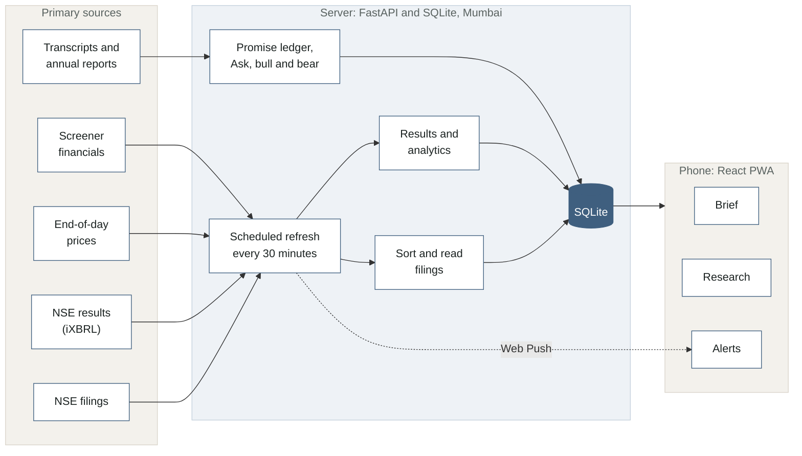

# FINN

**A brief you can finish, not a feed you scroll.**

FINN is a mobile-first investing agent for Indian equities. It reads every NSE filing and end-of-day move across a portfolio, tells you the few that matter, and checks what management promised against what it delivered.

**Open it on your phone:** https://finn-mu-three.vercel.app (then Add to Home Screen)

Built for the ENAM Holdings AI Engineer Build Challenge. It runs on live data from a server in Mumbai that refreshes through the trading day. Every claim below about data, models or numbers links to the [research log](docs/RESEARCH.md) (R1 to R17), where it was checked. Unfamiliar terms are explained in [Terms used here](#terms-used-here) at the end.

### Try it in two minutes

1. **Brief** (first tab): read the summary, then the cards under *Needs you*. Tap *Details* on a results card, or swipe a card right when you are done with it.
2. **Research** (second tab): open any company, say DIXON. The scorecard at the top gives six verdicts; *Narrative vs numbers* shows what management promised and what happened.
3. **Ask** (bottom of a company page): try "How did profit change last quarter?" or "What does EBITDA mean here?".
4. **Alerts** (third tab): drag the sliders and watch how many alerts your thresholds would have fired.
5. New to investing? In **Settings**, turn on *Explain the numbers*.

---

## The idea

Most investor apps never end: more filings, more news, more charts. FINN does the opposite. Each morning it gives you a short, ranked list of what changed in your portfolio. Each item says why it matters, in one line, with the numbers attached. You mark it done or dig in, and when the list is empty you are caught up.

- **Routine paperwork is counted, not shown.** "31 routine filings" is one line at the bottom: there to audit, never required reading.
- **Every item opens into research.** A results card does not stop at the numbers. It leads to the company's research brief, at the question that comes next: did this quarter land where management said it would?

## Push: the daily brief

| Feature | What you see | How it works |
| --- | --- | --- |
| Windowed digest | Every portfolio filing in the window you pick (24 hours by default; 3, 7 or 30 days), sorted into **Needs you**, **Worth knowing** and a folded **Routine** line. A short summary on top is written in code from the data. | Exchange label first, then text rules, then a small model only for what is left. In October 2026, half of all filings were placed by their label alone ([R2](docs/RESEARCH.md#r2-classifying-filings-labels-then-rules-then-a-model)). |
| Results card | Revenue, EBITDA, PBT and PAT with QoQ and YoY; margins and their change in basis points; how the stock traded in the next session; the company's promise ledger in one line. Banks get pre-provision profit and provisions. | Parsed from the exchange's own iXBRL filing, never generated, and cross-checked against Screener ([R4](docs/RESEARCH.md#r4-quarterly-results-from-nses-ixbrl-filings)). Notes explain what distorts a quarter: tax, other income, a one-off below EBITDA ([R5](docs/RESEARCH.md#r5-what-a-results-card-has-to-explain)). |
| Management change | Who joined or left, their role, family ties to the board as the filing states them, and a three-line career background with sources. | The person is read from the filing PDF, then a web search fills in their career. A background counts as confident only if a source names the company ([R3](docs/RESEARCH.md#r3-management-changes-and-executive-bios)). |
| Everything else | A one-line summary at the priority the category deserves. A stated amount is shown as a share of revenue, and for deals and fund raises of market cap. | When the exchange summary says nothing ("General Updates"), a small model reads the PDF. Polycab's insolvency filings concern a Rs 2.79 crore debt against Rs 9,899 crore of quarterly revenue ([R5](docs/RESEARCH.md#r5-what-a-results-card-has-to-explain)). |
| Promise ledger update | When a company files a new earnings call transcript, its promise ledger is rebuilt by itself and a card says what moved: "Promise ledger after the Nov 2026 call: 2 new promises." | The scheduled refresh spots the new transcript, rebuilds within the daily model quota, and compares old and new verdicts promise by promise ([R17](docs/RESEARCH.md#r17-ledgers-that-follow-new-calls)). |
| Alerts | Price and volume thresholds you set, filing types to always flag, and a notification on your phone when something new crosses them. | FINN replays your thresholds over the last 60 sessions so you tune "unusual" on real data: ±3% or 2x volume fires 119 alerts, ±5% or 3x fires 25 ([R8](docs/RESEARCH.md#r8-prices-and-how-many-alerts-a-threshold-fires)). Web Push sends each alert once ([R13](docs/RESEARCH.md#r13-push-notifications)). |

**What needs you.** This is a judgment call, so it is written down:

| Category | Priority |
| --- | --- |
| Results; a CEO, CFO, MD, chair or KMP joining or leaving; insolvency or regulator action; a rating downgrade; a pledge created or invoked | Needs you |
| Board changes and changes at subsidiaries; deals, fund raises, listings and capex; dividends; other legal matters; promoter sales; rating upgrades; monthly sales; results decks | Worth knowing |
| Meeting notices, certificates, investor meet schedules, newspaper copies, reaffirmed ratings, ESG scores | Routine |

On 30 filings held out from tuning, FINN's category matched a blind label on all 30 and its priority on 25. The 90 labelled filings run as a regression test in CI ([R2](docs/RESEARCH.md#r2-classifying-filings-labels-then-rules-then-a-model)).

## Pull: the research brief

Search any NSE company. FINN builds its brief from primary sources only: exchange filings, standardised financials, earnings call transcripts and the latest annual report. No news, no broker notes, and models are told not to use what they already know.

| Section | What it answers |
| --- | --- |
| Scorecard | Six verdicts at a glance (growth, margins, cash, balance sheet, track record, valuation), each a fixed rule printed in Help. Lenders get credit cost, returns and asset quality instead. |
| Business | What the company does; revenue mix by segment, segment margins and growth, from the segment table in the results filing. |
| Results and trajectory | The latest quarter, then five years of revenue, profit and margins. |
| Lending (banks) | Net interest income and its growth, gross and net NPA, CET1 and credit cost, from the bank's standalone filing ([R6](docs/RESEARCH.md#r6-bank-figures-come-from-the-standalone-filing)). |
| Balance sheet and cash | Borrowings, debt to equity, interest cover and funding mix; whether profit turns into cash. |
| **Narrative vs numbers** | What management promised on past calls, and what happened. |
| Guidance | Open targets from the same calls, grouped by metric. |
| Bull and bear | The case each way. Each point must join at least two cited facts ([R11](docs/RESEARCH.md#r11-keeping-model-answers-traceable-ask-and-bull-and-bear)). |
| Ask | Follow-up questions, answered from the filed results first, then the last four calls, then the annual report ([R7](docs/RESEARCH.md#r7-transcripts-and-annual-reports)). A beginner can ask what a term means, or whether a value is high, and gets FINN's own definition with this company's figure. |

**The promise ledger is the centre of Pull.** One model call reads the last four transcripts in order. For each forward-looking statement ("8 to 10% volume growth this year") it records the metric, target, timeframe, exact quote and page, then what later calls said. Python then checks everything:

- **Every quote is found in the transcript,** word for word, or the promise is not shown.
- **Revenue and profit promises** are settled against reported numbers: Delivered, Missed, On track or Off track, with the gap stated ("6.8%, 0.2 points below the 7% low end").
- **Margin promises** are settled in the definition management used. EBIT, EBITDA or PBDIT is rebuilt from the filed line items: TCS's filing gives an EBIT margin of 23.98%, and TCS said "24%" ([R10](docs/RESEARCH.md#r10-promise-ledger-what-can-be-checked-against-numbers)).
- **Segment and full-year targets** are checked against the segment's own rows and the quarters filed so far.
- **Revised** and **not mentioned again** are detected from later calls, and are never counted as misses.

Ledgers are built for all 17 portfolio companies that publish call transcripts (Trent publishes none), and any other company can build one from the app.

**New to investing?** Turn on *Explain the numbers* and every scorecard verdict and results figure gets a plain line: "Of every Rs 100 lent, about 37 paise is in loans that have stopped paying, after the money already set aside for them." Each line is written in code from the figure itself.

## Where AI is used, and where it is not

**Models read and judge text. Python does the arithmetic.** No percentage, ratio, growth rate or unit conversion comes from a model.

| Task | Method |
| --- | --- |
| Results, QoQ, YoY, margins, alerts | Parsed and computed in Python |
| Sorting filings | Exchange labels and text rules first; `gemini-3.1-flash-lite` for the rest, 20 per call |
| Reading vague filings, people and bios | `gemini-3.1-flash-lite`, five filings per call, with web search for careers |
| Promise ledger | `gemini-3.6-flash`, one call per company, with `gemini-3.8-flash` as fallback |
| Bull and bear, Ask | `gemini-3.5-flash-lite` |

**Measured, not assumed** ([R16](docs/RESEARCH.md#r16-measuring-the-ai-ask-and-the-promise-ledger)). Each AI feature has an eval in `eval/`, and CI re-scores the saved results:

| Eval | Result |
| --- | --- |
| Ask: 31 questions with known answers (figures, definitions, call quotes, annual report, out of scope) | 31 of 31; refuses all 5 questions its sources cannot answer |
| Ask in agent mode (the model looks things up with tools first) | 30 of 31, with a tenth of the input tokens (8,445 against 80,353 a question) and no rate-limit refusals, but 12.6 s against 5.2 s a median answer. The one-call mode stays the default; the agent is one setting away (`FINN_ASK=agent`) |
| Promise ledger: 20 promises drawn at random and read against their quotes | Targets right 18 of 20; verdicts right 16 of 20, 1 too cautious, 3 overclaimed "delivered" (prompt tightened since) |
| Filing classifier: 30 filings held out from tuning | Category 30 of 30, priority 25 of 30 |

**Guards against made-up answers:**

1. Models see only text FINN extracted from the source documents, and numbered facts it computed.
2. Every quote is matched against its PDF before it is shown, allowing for PDF glyphs but never a changed number.
3. Every number in an Ask answer must match a filed figure or a verified quote at the precision written; a sentence that does not is removed.
4. If the sources do not cover a question, the answer says so.

The free tier's limits shaped the design: Flash allows 20 requests a day, so the ledger is one call per company and every model output is stored once ([R9](docs/RESEARCH.md#r9-gemini-models-availability-speed-and-free-tier-limits)). One module (`backend/llm.py`) spaces calls to each model's per-minute limit, counts its daily use, honours retry hints and hands over to a sibling model when one is busy. Every call is logged with its tokens and latency.

| Model | Calls | Tokens in | Tokens out | Average latency |
| --- | --- | --- | --- | --- |
| `gemini-3.1-flash-lite` | 220 | 272,364 | 30,391 | 3.7 s |
| `gemini-3.5-flash-lite` | 142 | 1,760,447 | 48,504 | 3.4 s |
| `gemini-3.6-flash` | 104 | 1,565,932 | 59,281 | 8.2 s |
| `gemini-3.8-flash` | 10 | 268,543 | 9,118 | 61.5 s |
| **Total** | **476** | **3,867,286** | **147,294** | |

*Production server, 31 Oct to 3 Nov 2026. Cost: Rs 0, all on the Gemini free tier.*

## Architecture



- **Backend:** Python 3.12, FastAPI, SQLite. Scheduled jobs write and the API only reads, so responses take 7 to 24 ms, measured locally ([R12](docs/RESEARCH.md#r12-hosting-speed-and-uptime)). Responses are gzipped; model outputs and PDFs are stored once.
- **Frontend:** React, Vite and Tailwind CSS on Vercel, about 100 KB of JavaScript gzipped. An installable PWA that shows the last saved copy at once and refreshes in the background. Three themes and four accents, every combination at WCAG AA contrast ([R14](docs/RESEARCH.md#r14-colour-and-contrast)).
- **Hosting:** AWS Lightsail in Mumbai, always on, behind Caddy for HTTPS. Vercel serves the app and forwards `/api` to the server, so the address is a mainstream domain that office web filters allow ([R12](docs/RESEARCH.md#r12-hosting-speed-and-uptime)).
- **Schedule:** filings, results and filing reads every 30 minutes from 08:00 to 22:30 IST; prices after the close; financials and annual reports nightly. A watchdog restarts the API if it stops answering.

## Data sources

| Source | Used for | Worth knowing |
| --- | --- | --- |
| NSE announcements | Every filing | Needs a cookie from the NSE homepage, which itself answers 403 ([R1](docs/RESEARCH.md#r1-nse-filings-the-primary-source)). |
| NSE integrated filings (iXBRL) | Quarterly results, segments | The older results endpoint stops at Dec 2024. Revised filings list a quarter twice ([R4](docs/RESEARCH.md#r4-quarterly-results-from-nses-ixbrl-filings)). |
| NSE standalone filings (banks) | NPA, CET1, net interest income | The consolidated filing leaves NPA ratios at 0 ([R6](docs/RESEARCH.md#r6-bank-figures-come-from-the-standalone-filing)). |
| NSE and BSE PDFs | Transcripts, annual reports | Transcripts come from the company's own NSE filings; annual reports run to 756 pages and are searched page by page ([R7](docs/RESEARCH.md#r7-transcripts-and-annual-reports)). |
| Screener | Multi-year financials and ratios | Some companies stop filing consolidated results; FINN uses whichever basis is current ([R4](docs/RESEARCH.md#r4-quarterly-results-from-nses-ixbrl-filings)). |
| yfinance | End-of-day price and volume | The latest day can have volume but no close; such rows are dropped ([R8](docs/RESEARCH.md#r8-prices-and-how-many-alerts-a-threshold-fires)). |

## Companies

**Portfolio (18):** RELIANCE, TCS, HDFCBANK, ICICIBANK, INFY, LT, ETERNAL, TRENT, BAJAJ-AUTO, TATACONSUM, DIXON, POLYCAB, PERSISTENT, SONACOMS, MAXHEALTH, SUZLON, KAYNES, GRAVITA: large, mid and small caps across 14 sectors.

**Prepared for research:** ASIANPAINT, HAL, PIDILITIND and BAJFINANCE, an NBFC that keeps the lender logic honest. Any other NSE company works too: one FINN has never seen loads in about 5 seconds, and old names map to new ones (ZOMATO to ETERNAL).

## What we left out, on purpose

- **Intraday data.** The brief asks for end-of-day; intraday adds cost and noise without changing the workflow.
- **A chat-first interface.** Chat makes the investor do the asking. FINN leads with a finished brief and keeps Ask for follow-ups.
- **Vector search.** Four transcripts fit in one model call. Annual reports do not, so Ask picks their best six pages by keyword weight; embeddings would add a model and an index for a gain we could not show.
- **News and broker research.** Primary sources only, by design.

## Run it locally

```bash
# backend
cp .env.example .env                    # add GEMINI_API_KEY
uv sync
uv run python -m backend.jobs.refresh   # filings, prices, results, financials (about 3 minutes)
uv run python -m backend.enrich         # read vague and management filings
uv run uvicorn backend.main:app --port 8000
uv run pytest                           # 77 tests, including the classifier regression on 90 labelled filings

# frontend
cd frontend
bun install
bun run dev                             # http://localhost:5173, proxies /api to :8000
bun run test                            # 44 tests
```

**CI** runs on every push: ruff and pytest for the backend; type check, Vitest and a production build for the frontend; and a house-style check that fails on any en or em dash.

**Deploy:** the app is on Vercel (`cd frontend && vercel deploy --prod`). The server runs the API and the scheduled refresh: run `deploy/setup.sh` once, then `deploy/push.sh` ships backend changes.

## Where it goes next

- Bring the promise ledger into the brief: when a new transcript lands, say which promises changed status.
- Use the annual report in the snapshot and the ledger, not only in Ask.
- NBFC asset quality (stage 3 assets), which BAJFINANCE reports outside the integrated filing.
- Let users move a category's priority up or down, and learn from it.

## Terms used here

| Term | Meaning |
| --- | --- |
| NSE | National Stock Exchange of India, where these companies are listed and file their disclosures |
| Filing | A disclosure a listed company must send the exchange: results, board decisions, management changes, and more |
| iXBRL | The machine-readable version of a results filing, so numbers can be read exactly instead of guessed from a PDF |
| QoQ, YoY | Change against the previous quarter, and against the same quarter a year earlier |
| EBITDA | Profit from running the business, before interest, depreciation and tax (FINN leaves out other income) |
| PBT, PAT | Profit before tax, and profit after tax (what is left for shareholders) |
| Basis points (bps) | Hundredths of a percentage point: a margin moving from 17.0% to 15.6% is -140 bps |
| P/E | Price to earnings: what buyers pay for every Rs 1 of a company's yearly profit |
| NPA, CET1 | A bank's loans that have stopped paying; and its core capital as a share of its risk-weighted assets |
| Earnings call | The call where management discusses a quarter's results with analysts; FINN reads the transcripts |
| Promise ledger | FINN's record of what management promised on those calls, checked against what was later reported |
| PWA | Progressive web app: a website you can add to your phone's home screen and use like an app |

## Build history

FINN was built with AI over five days. [build-history.md](build-history.md) tells the short version: how the work was split, what happened each day, and what the checks caught.
